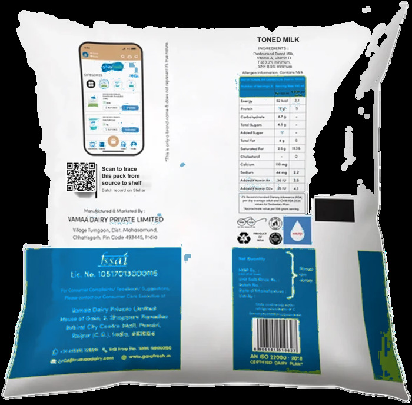
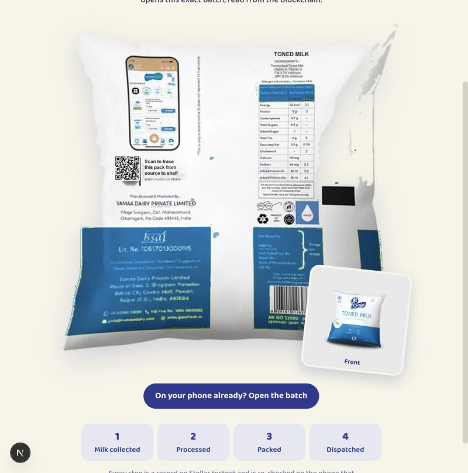
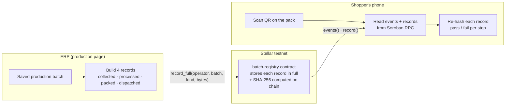
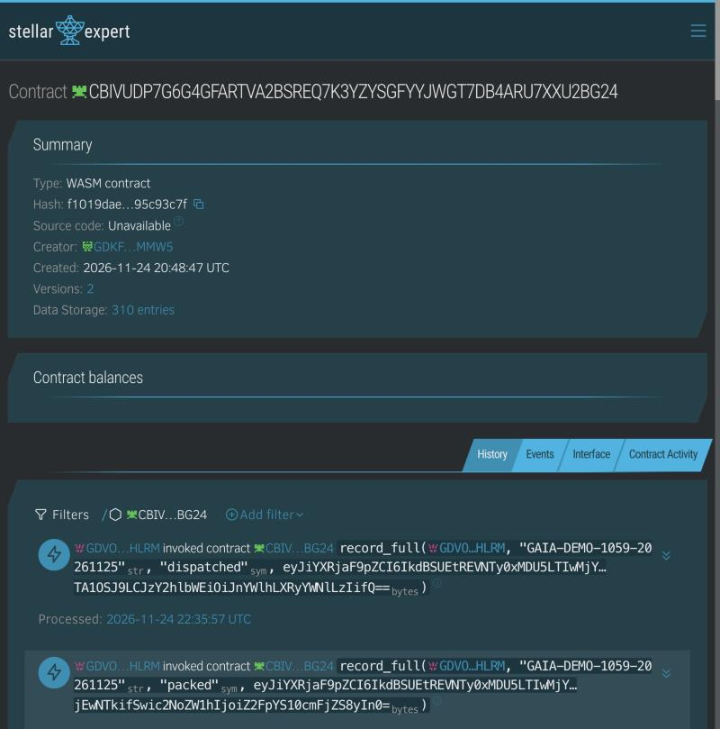
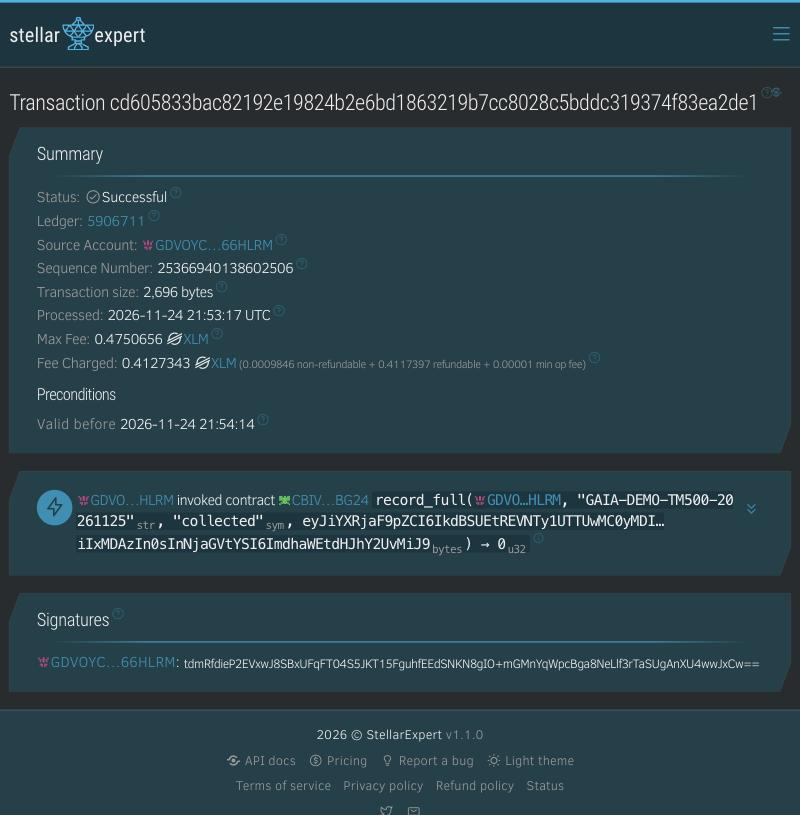

# Imprint: batch provenance for dairy and daily consumables on Stellar

Every product batch gets a public **digital twin** in a Soroban contract. Each step of its journey (milk collected, processed, packed, dispatched) is stored **in full on chain**, and the contract computes each record's SHA-256 itself. A QR printed on the pack opens a page that reads the records **straight from Stellar** and re-checks every fingerprint on the shopper's own phone, so nothing about the batch depends on trusting a company server.

> Live on Stellar **testnet**, recording from a real ERP, with demo batches for 50 packaged products.

| | |
|---|---|
| Live demo | [production.vamadairy.in/trace/demo](https://production.vamadairy.in/trace/demo) |
| Batch the QR opens | [production.vamadairy.in/trace/GAIA-DEMO-TM500-20261125](https://production.vamadairy.in/trace/GAIA-DEMO-TM500-20261125) |
| Contract | [`CBIVUDP7…ARU7XXU2BG24`](https://stellar.expert/explorer/testnet/contract/CBIVUDP7G6G4GFARTVA2BSREQ7K3YZYSGFYYJWGT7DB4ARU7XXU2BG24) on stellar.expert |
| Demo video | [Google Drive](https://drive.google.com/file/d/1V38ayatdwI3FAFtZd6fTvgqbrVJkLs-Y/view?usp=sharing) |
| ERP integration | [github.com/VamaaDairy/Dashboard](https://github.com/VamaaDairy/Dashboard) |

---

## The pack

The QR sits on the back of the pouch, where a pack already carries its printed codes. Scanning it opens the batch.

<p align="center">
  
  &nbsp;
</p>

<p align="center">
  <br>
  <sub>Scan with a phone camera: opens <code>GAIA-DEMO-TM500-20261125</code></sub>
</p>

The demo page shows the same pack, ready to scan from a screen:

<p align="center"></p>

---

## How it works



1. **Record.** On the ERP's production page, a saved batch is recorded in up to four steps built from plant data. Re-recording sends only the steps that changed.
2. **Store.** `record_full` stores the exact bytes of each step's JSON on chain and anchors their SHA-256, computed by the contract, so the stored data and its fingerprint can never disagree.
3. **Verify.** The public batch page fetches `events(batch)` and `record(batch, i)` over RPC, re-hashes every record with Web Crypto in the browser and shows a pass or fail for each step.

---

## On-chain proof

Everything below can be checked on the explorer, without our servers.

| Step (demo batch `GAIA-DEMO-TM500-20261125`) | Ledger | Transaction | Anchored SHA-256 |
|---|---|---|---|
| 1 · collected | 5,906,711 | [`cd605833…83ea2de1`](https://stellar.expert/explorer/testnet/tx/cd605833bac82192e19824b2e6bd1863219b7cc8028c5bddc319374f83ea2de1) | `0dc78b3e…2db69a27` |
| 2 · processed | 5,906,712 | [`76800e41…c2282eae`](https://stellar.expert/explorer/testnet/tx/76800e410d7cf5f429f94cb211de36d690c41d155f2307aacfd2715dc2282eae) | `071e4d71…4f2fb617` |
| 3 · packed | 5,906,713 | [`a38538e7…f894b08404`](https://stellar.expert/explorer/testnet/tx/a38538e70d7b8e5bf97cadfb9881b363fa368b7792ba56fffb89d9f894b08404) | `fccef279…b78d15f4` |
| 4 · dispatched | 5,906,714 | [`d4295f8c…1aca569c9`](https://stellar.expert/explorer/testnet/tx/d4295f8c788f592c70ef548dbe3bed18542bf0dacf287cee684c0ea1aca569c9) | `f7bb1d9c…2dfa48dc` |

| Account | Role |
|---|---|
| [`GDVOYCKV…RD66HLRM`](https://stellar.expert/explorer/testnet/account/GDVOYCKVAYQOYOLPOJCXY4VTSHJ6OR7K4NYLWDAIPVGL43AYRD66HLRM) | Operator: writes the records (259 successful transactions) |
| [`GDKFNWH2…P4DFMMW5`](https://stellar.expert/explorer/testnet/account/GDKFNWH22JU2FWSIKC3NUURMOU6ZYOADVOAHHMPLFABRP5KWP4DFMMW5) | Admin: deployed and controls the contract |

<p align="center">
  
  &nbsp;
  
</p>

**Check it yourself.** Read the `packed` record back from the chain and hash it: the result equals the anchored hash above.

```bash
stellar contract invoke --id CBIVUDP7G6G4GFARTVA2BSREQ7K3YZYSGFYYJWGT7DB4ARU7XXU2BG24 \
  --source-account <any> --network testnet --send=no \
  -- record --batch_id GAIA-DEMO-TM500-20261125 --index 2 | tr -d '"' | xxd -r -p | shasum -a 256
# fccef2790dae0fd9f06d945d1eb3ad97f8e4826e61daba9985c739ecb78d15f4
```

The decoded record is in [`docs/packed-record-example.json`](docs/packed-record-example.json).

---

## The contract: `contracts/batch-registry`

| | |
|---|---|
| Network | Stellar **testnet** |
| Contract ID | `CBIVUDP7G6G4GFARTVA2BSREQ7K3YZYSGFYYJWGT7DB4ARU7XXU2BG24` |
| WASM hash | `f1019dae…95c93c7f` (v2, upgraded in place from v1) |
| Language | Rust, soroban-sdk 29, compiled to WebAssembly |
| Tests | 7 unit tests, including an independent SHA-256 check |

**Writes** (operator keys only, except where noted)

| Function | What it does |
|---|---|
| `create_batch(operator, batch_id, product)` | Creates the batch twin, held by the operator |
| `record_full(operator, batch_id, kind, data) -> index` | **v2.** Stores the record's exact bytes on chain (up to 16 KB) and anchors their SHA-256, computed by the contract |
| `anchor(operator, batch_id, kind, hash, uri) -> index` | v1. Anchors only a hash; the record lives at `uri` |
| `move_twin(batch_id, to)` | The holder hands the twin on |
| `keep_alive(batch_id)` | Anyone can extend storage for the twin, its anchors and records |
| `set_operator(addr, bool)` · `set_admin(addr)` · `upgrade(wasm_hash)` | Admin only |

**Reads:** `batch(id)`, `events(id)`, `record(id, index)`, `verify(id, hash)`, `admin()`, `is_operator(addr)`

**Events:** `batch_created`, `anchored`, `twin_moved`

**Limits:** 64 anchors per batch, ids up to 64 characters, records up to 16 KB. Storage is extended to about a year on every write.

### What a record holds

Each step is canonical JSON (`schema: gaia-trace/2`, keys sorted, no spaces):

| Step | Public facts |
|---|---|
| `collected` | Village centres that filled the tanks the batch drew from: litres, fat, SNF, pours, farmer count |
| `processed` | Plant with GPS, milk used and its blend, lab test (fat, SNF, CLR), ingredients, yield |
| `packed` | SKU and pack size, packs made, use-by from shelf life, storage, typical nutrition |
| `dispatched` | Trucks that carried the SKU: route, vehicle, departed and arrived, stops delivered |

Never published: costs and rates, farmer and customer names, tank names, recipe quantities.

---

## Tech stack

| Layer | Technology |
|---|---|
| Smart contract | Soroban, Rust, soroban-sdk 29, Stellar CLI |
| Network | Stellar testnet via public Soroban RPC |
| Recording (ERP) | Next.js 16 server actions, PostgreSQL, `@stellar/stellar-sdk` |
| Public batch page | React 19, Stellar SDK reads over RPC, Web Crypto SHA-256 |
| QR codes | `qrcode`, `pdf-lib` for the printable sheet |

## Repository

```
contracts/batch-registry/   the Soroban contract and its tests
demo-qr/                    QR codes for the 50 demo product pages, printable PDF, links CSV
docs/                       README images and a decoded on-chain record
services/anchor/            first prototype: standalone Rust (axum) anchoring service (v1)
verify/                     first prototype: standalone Vite + React verify page (v1)
```

The live recording flow and the public `/trace/<batch>` page live in the ERP: [github.com/VamaaDairy/Dashboard](https://github.com/VamaaDairy/Dashboard) (`src/lib/trace`, `src/app/trace`, `src/app/daily/trace-actions.ts`).

## Build and test

```bash
cargo test                      # contract unit tests
stellar contract build          # -> target/wasm32v1-none/release/batch_registry.wasm
```

Read a batch straight from the chain:

```bash
stellar contract invoke --id CBIVUDP7G6G4GFARTVA2BSREQ7K3YZYSGFYYJWGT7DB4ARU7XXU2BG24 \
  --source-account <any> --network testnet --send=no -- events --batch_id GAIA-DEMO-TM500-20261125
```

Upgrade the deployed contract (admin key):

```bash
stellar contract upload --wasm target/wasm32v1-none/release/batch_registry.wasm --source-account <admin> --network testnet
stellar contract invoke --id CBIVUDP7G6G4GFARTVA2BSREQ7K3YZYSGFYYJWGT7DB4ARU7XXU2BG24 \
  --source-account <admin> --network testnet -- upgrade --wasm_hash <hash>
```

## Demo data

50 demo batches, one per product, with dummy figures labelled DEMO, e.g. [`GAIA-DEMO-TM500-20261125`](https://production.vamadairy.in/trace/GAIA-DEMO-TM500-20261125). All QR codes: [`demo-qr/gaia-all-qr-codes.pdf`](demo-qr/gaia-all-qr-codes.pdf); all links: [`demo-qr/demo-links.csv`](demo-qr/demo-links.csv).

## Next: multi-party signing

Today one operator key writes every step. The next phase gives each step its author:

- **Contract v3:** parties registered by role (collection centre, processor, packer, carrier, distributor); each step accepted only with Soroban authorization from its role holder, in order; handoffs complete when the receiver confirms; recall flag.
- **Passkey signing:** each party signs its own step from a phone with Smart Account Kit passkey smart accounts (Stellar Wallets Kit for existing wallets). No seed phrase, and no key on any server.
- **Verification kit:** a package and scan page that show who signed each step and when, reusable with any brand's contract.

Mainnet follows an independent review. Keys and `.env` files are git-ignored and never committed.
